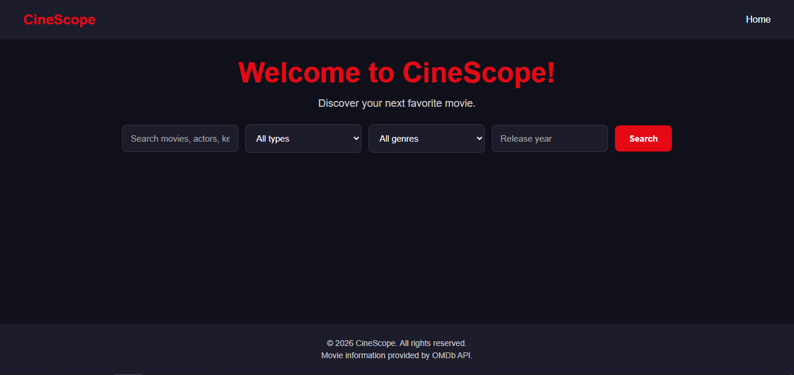
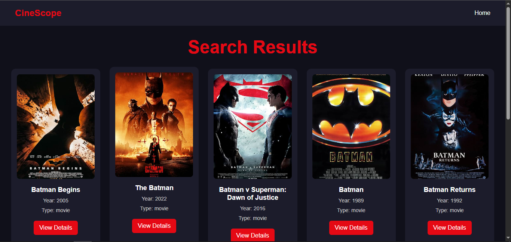
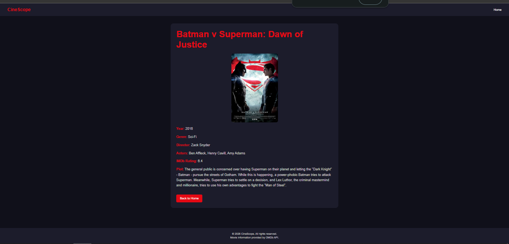
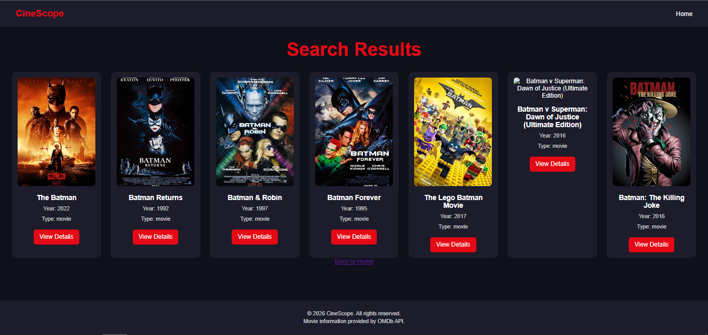
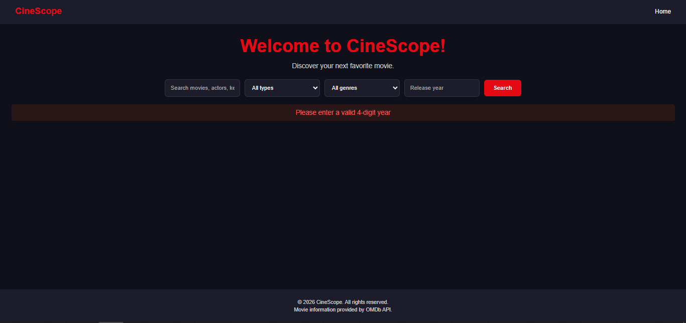

# CineScope – Movie Discovery Website

## Project Description
CineScope is a movie discovery website that allows users to search for movies and TV series using the OMDb API.

Users can search by title and filter results by content type, release year, and genre. They can also open a movie to view detailed information.

## API Used
- API: OMDb API
- Website: https://www.omdbapi.com/
- Search endpoint: `https://www.omdbapi.com/?s=movie-title`
- Movie details endpoint: `https://www.omdbapi.com/?i=imdbID`

## Technologies
- Node.js
- Express.js
- Axios
- EJS
- CSS
- OMDb API

## Main Features
- Search movies by title
- Filter by movie, series, or episode
- Filter by release year
- Filter by genre
- View detailed movie information
- Responsive design
- Input validation
- Error handling

## Project Structure
- `app.js` – Main application file
- `routes/` – Application routes
- `controllers/` – Handles user requests
- `services/` – Communicates with OMDb API
- `middleware/` – Custom middleware
- `views/` – EJS pages and partials
- `public/` – CSS and static files

## Main Routes
- `GET /` – Home page
- `GET /search` – Search movies
- `POST /search` – Search movies using the form
- `GET /movie/:id` – Movie details

## Installation

1. Clone the repository.
2. Install dependencies:

   `npm install`

3. Create a `.env` file in the root folder.
4. Add your OMDb API key:

   `PORT=3000`
   
   `OMDB_API_KEY=your_api_key_here`

5. Start the application:

   `npm start`

6. Open `http://localhost:3000` in your browser.

## Author
Student Web Development Project – 2026

## Screenshots

### 1. Home Page

### 2. Search Results

### 3. Movie Details

### 4. Genre Filter

### 5. Error Handling

